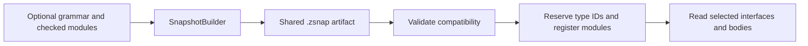

# Language snapshots

A `.zsnap` artifact packages a language's optional compiled grammar, checked
modules and optional lowered HIR. A host installs it before checking user source
so the runtime can reserve its type IDs and register its modules.

This reference covers artifact preparation and reuse. Language selection, type
boundaries and symbol resolution are covered in [Cross-language imports](language-integrations/cross-language-imports.md).

## Build and install



A build script supplies already checked programs:

```rust
let path = zyntax_embed::SnapshotBuilder::new("demo")
    .module("prelude", checked_program)?
    .build_in(&out_dir)?;
```

`build_in` chooses the filename. `include_snapshot!` uses the same convention
under `OUT_DIR`, so hosts do not repeat filenames or format extensions:

```rust
let snapshot = std::sync::Arc::new(zyntax_embed::Snapshot::load(
    zyntax_embed::include_snapshot!("demo"),
)?);
runtime.install_snapshot(snapshot)?;
```

`install_snapshot` validates compatibility, registers the grammar when present,
reserves recorded type IDs and registers modules without decoding all their
bodies. Keep the `Arc<Snapshot>` available for reuse across runtimes.

For grammar-based frontends, `.grammar(grammar.to_compiled_bytes()?)` includes the
compiled parser. Native frontends can omit it. Host resolver callbacks remain
available for modules not packaged in the snapshot.

## Module representations

| Builder method | Saved data | Work remaining when consumed |
| --- | --- | --- |
| `module` / `module_ref` | Checked typed AST | Native lowering and optimization |
| `module_with_source` | Checked AST plus original source | Same, with explicit source available for reparsing |
| `module_lowered` | Body-free declarations, signatures/interfaces and split HIR | Decode reached bodies and execute; JIT compilation remains runtime work |

`module_ref` borrows the checked program during encoding. `module_lowered`
consumes its program and strips executable AST bodies; matching HIR is required
for execution. Use shared `lower_for_snapshot_releasing` for library preparation,
or `TieredRuntime::prepare_typed_program_snapshot` to prepare a linked project
under the runtime's native policy. Preserve generic templates and use the same
release policy as the consuming runtime.

HIR uses the existing [bytecode encoding](BYTECODE_FORMAT_SPEC.md). A snapshot
contains neither a live heap nor native machine code. Programs still start in
the interpreter and may promote through the JIT tiers.

### Read only what is needed

- `module_interface` reads a compact interface when present; otherwise it falls
  back to the module. `function_signature` reads a saved signature independently.
- Split HIR keeps unused function bodies encoded. Embedded images borrow their
  bytes; lazy modules share ownership through `Arc`.
- `into_modules` consumes decoded programs instead of cloning them. A single
  owned lowered module reuses its image allocation for the encoded HIR.
- `modules` requests every module; avoid it when only selected imports are needed.

Checked programs retain their source-file metadata. `module_with_source` also
provides text through `module_source` for hosts choosing to reparse.

## Compatibility and build inputs

Readers check format versions and compiler fingerprints before decoding typed or
HIR payloads. Lowered entries also validate target pointer size. Installation,
interface/signature access and lazy body reads enforce compatibility; errors
identify the affected module and incompatible identity.

A host can rebuild an incompatible snapshot or check its original source.
Body-stripped declarations are not an executable source fallback. Raw AST entries
retain their bodies and continue through normal native lowering.

Snapshot-generating build scripts call
`zyntax_compiler::track_snapshot_build_inputs()` so incremental regeneration watches
the shared compiler/type/codec inputs. Frontends must also track their own parser,
checking policy and native primitive dependencies.

## Validated project caching

`SnapshotCache` adds checked-source records to the ordinary snapshot format;
frontends do not need another cache container.

1. Record every checked file with `SnapshotSource`, including type-only files and
   resolved dependency edges.
2. Call `load` with the frontend's current resolver. It validates source hashes,
   import resolution, options, frontend/compiler/target identity and payload
   checksum. Missing, stale, corrupt or incompatible entries are misses.
3. Use `store` to encode and atomically publish a complete entry. Alternatively,
   `prepare` returns an in-memory snapshot and `publish` writes it atomically.
   Publication failure leaves the prepared value usable by the current process.

A cache hit skips only the stages represented in the artifact: checked AST skips
parsing/checking; compatible HIR also reuses native lowering and optimization.
Artifact validation and runtime installation still run. Treat the cache directory
as trusted local build storage.

See [TypeScript caching](language-integrations/typescript/architecture.md#persistent-project-cache)
for a frontend integration. Keep measurements and work journals in git-bug.
