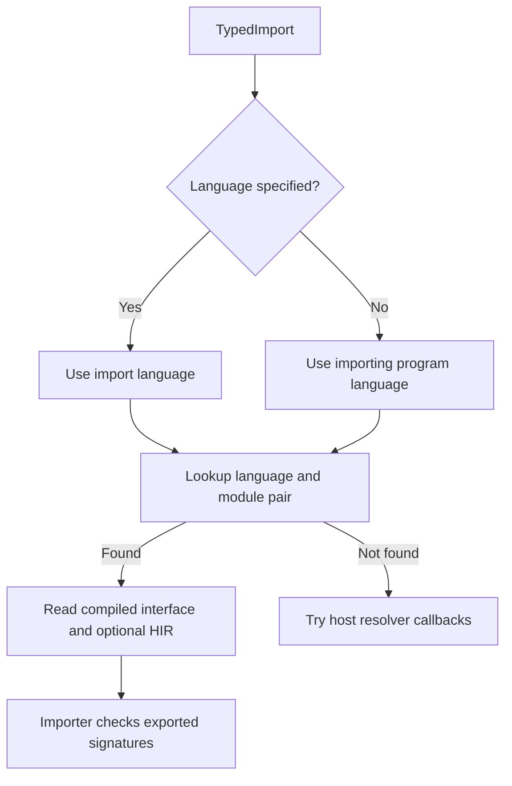

# Cross-language imports

Zyntax's shared typed AST and HIR let frontends link modules through one runtime.
Language-qualified module lookup is available in the shared import chain;
source syntax, checker integration and value compatibility remain each frontend's
responsibility. Installing two snapshots alone does not establish interoperability.

See [Language snapshots](../SNAPSHOT_API.md) for packaging and installation.

## Language selection

The frontend records an optional language in `TypedImport::language`, separately
from `module_path`. A module named `python` is therefore distinct from selecting
the Python language. Source spelling belongs to the frontend, not the runtime.

Two installed languages can each register a `prelude`; snapshot lookup chooses
the `(language, module)` pair. Transitive imports use the imported program's own
language. A compiled import can be supplied by a native frontend without a
registered grammar.

**Legacy fallback is not language-scoped.** Resolver callbacks receive a bare
module name, and the first callback to answer wins. Source fallback tries
registered grammars until parsing succeeds. Explicit language selection governs
snapshot lookup; a miss still reaches these callbacks. Shared traversal also
tracks processed imports by bare module name, so scoped lookup alone does not
resolve every collision in a mixed-language graph.

## Type and value boundaries

An importing checker reads exported declarations in the shared type vocabulary.
It does not adopt the exporting language's type system.

| Exported value | Boundary requirement |
| --- | --- |
| Primitive | Agree on the native representation and calling convention |
| `Any` or another dynamic value | The importer must accept the type and support the required boxing/unboxing |
| Nominal object or container | Preserve its registry identity; similar names or shapes do not establish compatibility |
| Borrowed or owned reference | Preserve lifetime, retention and ownership rules across the call |

Shared HIR avoids a separate execution engine for the call. It does not prove
that arbitrary frontend values can cross without adapters. A Python export
carrying `Any`, for example, does not automatically become a usable TypeScript
`any` implementation. Container layouts, string representation and memory policy
must be compatible or explicitly bridged.

Exceptions, effects and async behavior also need an agreed contract. A raised
error does not become a rejected promise merely because both functions use HIR.

## Symbols and aliases

Module selection and function identity are separate concerns. Frontends must
retain a callable's original module identity when declarations are linked.
Local backend symbols already use function IDs; host-visible export names and
source-level lookup need their own unambiguous identities.

Renaming `add` to `pyAdd` changes the local binding, not the function's exported
identity. It cannot repair a collision in a bare-name symbol table. Likewise,
`link_name` names an external ABI symbol; it is not a namespace mechanism for
ordinary local functions. See the [symbol identity design](../SYMBOL_IDENTITY.md).

The TypeScript frontend qualifies its native identities by `ModuleId` and retains
checker interfaces across imports. That supports its native module integration;
it is not a claim that TypeScript-to-Python imports are complete. Frontend support
is described in the [TypeScript compatibility guide](typescript/compatibility.md).
