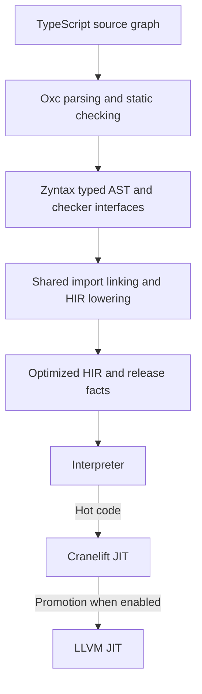
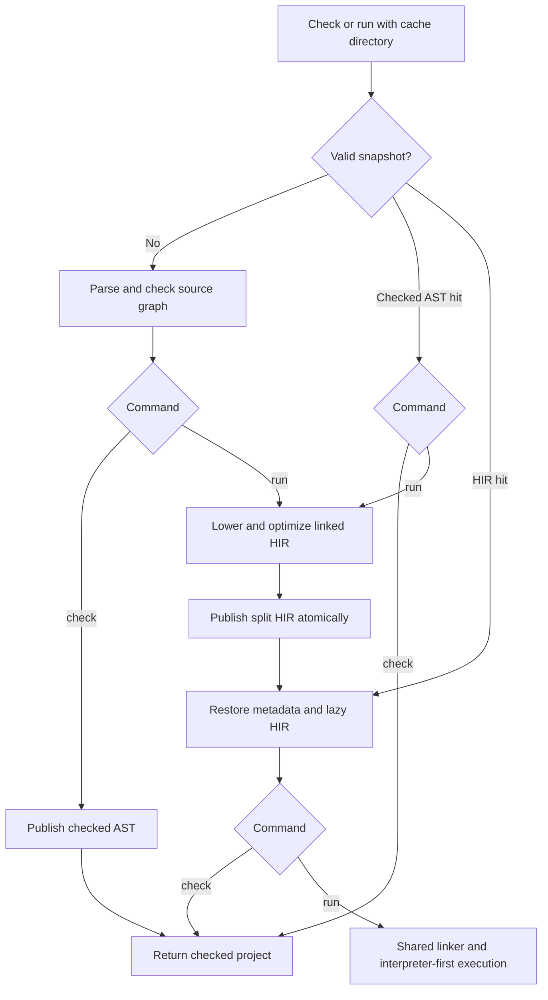

# TypeScript architecture

[Quick start](../../../crates/zyntax_ts/README.md) · [Compatibility](compatibility.md) · [Testing](testing.md)

The frontend produces Zyntax's typed AST. Shared compiler, import, ownership and
snapshot infrastructure handles native execution; TypeScript does not have a
separate linker or cache format.

## Compilation and execution

Execution always starts in the interpreter. Short programs may finish before
promotion. To enable LLVM, build with `--features llvm-backend` and run with
`--llvm`. Native compilation is separate from persistent HIR caching.

### Frontend and module identities

- Interned identities, borrowed source spellings, Fx maps, shared signatures and
  cached layouts limit frontend allocations. A dependency worklist resolves
  function signatures before each body is checked and lowered once.
- `parse_program` derives module identity from the filename. `parse_module`
  accepts a canonical `ModuleId` independently of the diagnostic filename.
  Functions, lifted arrows, bindings and layouts are module-qualified;
  hosts obtain callable names with `ModuleId::function_name`.
- `parse_module_with_dependencies` checks imports against exported checker interfaces.
  `TypedProgram::checker_interface` retains signatures, readonly views, generic
  parameters, layouts, borrow facts and array result summaries without bodies.
- `load_project` checks canonical filesystem dependencies. `SourceProject::into_parts`
  moves runtime-reachable programs into the shared compiled-import resolver;
  type-only bodies are omitted. Shared initialization roots preserve evaluation order.

### Native representations and memory

Generic functions use the shared HIR specializer's cached concrete instances.
Dense arrays use native list storage and typed GEPs (element-address calculations),
loads and stores. Length/push use inline list operations. Canonical array loops
use integer induction; a counter used as a TypeScript value converts to `number`.
Bounds proofs follow literals, aliases, return summaries, guards and loops.

The runtime enables automatic release with `Collector::None`. Shared `drop_insert`
analysis distinguishes borrows, returned aliases and fresh owned storage, then
uses retention and liveness facts to insert frees. Returning fresh storage
transfers ownership; derived aliases share its lifetime. This follows Rayzor's
`insert_free` separation of borrow, alias and ownership facts. Static typing alone
is not a lifetime proof; unsupported escaping graphs are rejected.

Scalar unions use native tags and payloads without heap boxing. Capture-free
function references retain native signatures without allocating environments.

## Persistent project cache

`--cache-dir DIR` opts into trusted local `.zsnap` build artifacts. Shared
`SnapshotCache` validates source contents, transitive/type-only dependencies,
resolution, soundness policy and compiler/frontend/target identities before reuse.

- `load_project_cached` creates checked-only entries without native lowering. It
  can also read HIR entries. `load_project_for_runtime` installs TS primitives
  and prepares execution entries under the runtime's native policy.
- A first run upgrades a checked entry. Cold HIR preparation currently lowers
  and optimizes the complete linked project synchronously, before execution.
- HIR entries retain checker metadata, exported generic templates and release
  facts. Unused split bodies stay encoded until reached. An owned single-module
  image moves into the lazy reader without a second allocation for all bodies.
- No native machine code is persisted. Initializers execute once per runtime,
  not during cache preparation. Invalid entries rebuild from source; publication
  failure leaves the prepared project usable by the current process.

See the [shared snapshot API](../../SNAPSHOT_API.md) for artifact details.
Performance measurements, work logs and pending changes belong in git-bug.
